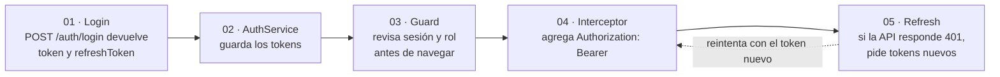
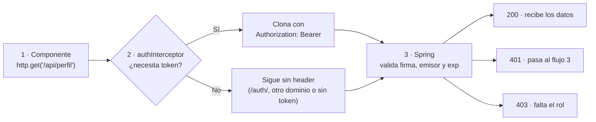
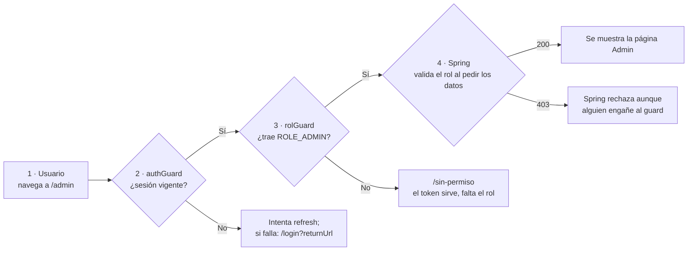
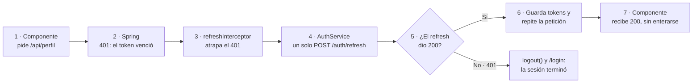
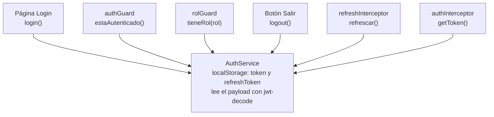

# Implementación: guards, interceptors y refresh token en Angular

Este proyecto es el frontend del backend [jwt-demo](../jwt-demo) (Spring Boot). Muestra las tres piezas que usan el JWT en el navegador:

1. **Guards**: deciden si el usuario puede entrar a una ruta.
2. **Interceptors**: agregan `Authorization: Bearer <token>` a cada petición.
3. **Refresh token**: cuando el token vence, piden uno nuevo y repiten la petición sin que el usuario lo note.

Los cambios del backend (endpoint `/auth/refresh`, CORS, etc.) están explicados en [jwt-demo/IMPLEMENTACION.md](../jwt-demo/IMPLEMENTACION.md).

Angular 21, componentes *standalone*, guards e interceptors **funcionales** y la librería [`jwt-decode`](https://www.npmjs.com/package/jwt-decode) para leer el payload.

**Contenido:** [Teoría](#teoría-por-qué-existen-estas-piezas) · [El recorrido del token](#el-recorrido-del-token) · [Estructura](#estructura) · [Los tres flujos](#los-tres-flujos) · [AuthService](#0-la-base-authservice) · [Guards](#1-guards) · [Interceptors](#2-interceptors) · [Refresh token](#3-refresh-token) · [Cómo ejecutarlo](#cómo-ejecutarlo) · [Pruebas](#pruebas) · [Repositorio y commits](#repositorio-y-commits)

## Teoría: por qué existen estas piezas

Cada pieza responde una pregunta que aparece cuando el servidor no guarda sesiones.

### 1. Si el servidor no guarda sesiones, ¿quién recuerda que iniciaste sesión?

| Sesión con estado | JWT sin estado (`SessionCreationPolicy.STATELESS`) |
|---|---|
| El servidor guarda la sesión en memoria; el navegador solo envía una cookie (`JSESSIONID`). | El servidor no recuerda nada. Cada petición trae un token firmado con todo lo necesario: quién es (`sub`), sus roles y cuándo vence (`exp`). |

**Consecuencia:** el frontend se vuelve responsable del token. Debe guardarlo, enviarlo en cada petición y renovarlo cuando vence.

### 2. Si cada petición debe traer el token, ¿quién se lo pone?

Ponerlo a mano en cada servicio (`headers: { Authorization: ... }`) trae tres riesgos:

- **¿Y si un servicio lo olvida?** Un 401 difícil de rastrear.
- **¿Y si cambia el formato?** Hay que tocar cada archivo.
- **¿Y si llamamos a otro dominio?** El token se filtra a terceros.

**Solución: un interceptor**, un solo punto por el que pasan todas las peticiones de `HttpClient`.

### 3. Si el usuario escribe `/admin` en la barra, ¿quién lo detiene?

En una SPA las rutas viven en el navegador: el Router de Angular cambia la vista sin preguntarle al servidor. Sin control, la página de administración se pinta vacía y luego la API responde 403. ¿Cómo mandamos al login y luego de vuelta a donde iba?

**Solución: guards.** El Router les pregunta antes de activar la ruta: sin sesión → `/login`, sin rol → `/sin-permiso`.

### 4. Si el navegador puede leer el token, ¿puede confiar en lo que dice?

Un JWT es `header.payload.firma`. El header y el payload son Base64: cualquiera los lee (por ejemplo en [jwt.io](https://jwt.io)) y los edita.

| El navegador sí puede | El navegador no puede |
|---|---|
| Leer y editar el payload, por ejemplo cambiar `ROLE_USER` por `ROLE_ADMIN`. | Verificar la firma: la clave HS256 solo existe en el servidor. |

**Conclusión:** el frontend lee el token para decidir qué **mostrar**; Spring lo verifica para decidir qué **permitir**. Si alguien edita su rol, el guard lo dejaría pasar, pero `JwtAuthenticationFilter` rechaza el token porque la firma ya no coincide.

### 5. ¿Cuánto debería durar un token?

| Token largo (7 días) | Token corto (15 minutos) |
|---|---|
| + Casi nunca hay que volver a iniciar sesión | + Si lo roban, sirve pocos minutos |
| − Si lo roban, sirve días | − Cada 15 minutos hay que escribir la contraseña |
| − Sin estado, el servidor no puede revocarlo | − El usuario pierde lo que estaba haciendo |

**El dilema:** ningún valor único es seguro y cómodo a la vez. ¿Se puede tener un token corto sin castigar al usuario?

### 6. ¿Y si separamos el permiso de entrar del permiso de renovar?

| | Access token | Refresh token |
|---|---|---|
| Sirve para | Entrar a la API | Pedir un access token nuevo |
| Dura | 15 minutos | 7 días |
| Viaja | En cada petición, en `Authorization` | Solo a `POST /auth/refresh` |
| Lleva roles | Sí | No |

El que más se expone dura poco; el que dura mucho casi no se expone. **Solución: refresh token.** Queda una pregunta: ¿en qué momento se usa?

### 7. ¿En qué momento se usa el refresh token?

**Solo cuando el access token deja de servir**: al recibir un **401** de la API o al **navegar** con `exp` vencido. No en cada petición (lo expondría sin necesidad), no ante un **403** (renovar no cambia el rol) y no ante un **401 de `/auth/refresh`** (la sesión terminó). El detalle está en [¿En qué momento se usa el refresh token?](#en-qué-momento-se-usa-el-refresh-token).

### 8. Tres problemas, tres piezas

| Problema | La pregunta | Pieza |
|---|---|---|
| Enviar el token siempre | ¿Cómo no repetirlo en cada servicio? | **Interceptor** |
| Proteger rutas del cliente | ¿Quién decide si entra a `/admin`? | **Guard** |
| El token vence | ¿Cómo seguir sin pedir la contraseña? | **Refresh token** |
| El cliente no es confiable | ¿Quién tiene la última palabra? | **Spring**: firma, 401 y 403 |

Las tres piezas del frontend comparten un `AuthService`, el único que sabe dónde está el token.

## El recorrido del token



## Estructura

```
src/app
├── app.config.ts            provideHttpClient(withInterceptors([authInterceptor, refreshInterceptor]))
├── app.routes.ts            rutas con canActivate
├── app.ts / app.html        barra de navegación (muestra el usuario y el enlace Admin)
├── core
│   ├── api.ts               API_URL = http://localhost:8080
│   ├── models.ts            LoginResponse, TokenPayload, Usuario, Producto
│   ├── services
│   │   └── auth.service.ts  guarda y lee los tokens, login, refrescar, logout
│   ├── guards
│   │   ├── auth.guard.ts    ¿hay sesión vigente?
│   │   └── rol.guard.ts     ¿tiene el rol de data.rol?
│   ├── interceptors
│   │   ├── auth.interceptor.ts     pone el header Authorization
│   │   └── refresh.interceptor.ts  ante un 401 refresca y reintenta
│   └── testing/tokens.ts    arma JWT de prueba para los tests
└── pages
    ├── login                formulario; al entrar vuelve a returnUrl
    ├── productos            público; crear pide token; eliminar pide ADMIN
    ├── perfil               ruta con authGuard; muestra el payload y cuánto le queda al token
    ├── admin                ruta con authGuard + rolGuard (ROLE_ADMIN)
    └── sin-permiso          a donde manda rolGuard
```

## Los tres flujos

Antes de ver cada archivo, así se mueve el token en los tres casos que importan.

### Flujo 1 · Interceptor: una petición normal



`refreshInterceptor` no hace nada a la ida: solo mira la respuesta cuando vuelve.

| Respuesta | Significa | Qué pasa después |
|---|---|---|
| **200** | Token válido | El componente recibe los datos |
| **401** | Sin token o token vencido | Entra el **flujo 3** (refresh) |
| **403** | Token válido, pero sin el rol | Se muestra el error; refrescar no lo arregla |

Si la URL es de `/auth/`, de otro dominio, o no hay token, la petición sigue **sin** header.

### Flujo 2 · Guards: navegar a `/admin`



| Paso | Quién | Pregunta | Sí | No |
|---|---|---|---|---|
| 1 | Usuario | Escribe `/admin` o pulsa el enlace | | |
| 2 | `authGuard` | ¿Hay sesión vigente? | Sigue | Intenta refresh; si no hay o falla → `/login?returnUrl=/admin` |
| 3 | `rolGuard` | ¿El token trae `ROLE_ADMIN`? | Sigue | `/sin-permiso` |
| 4 | `Admin` + Spring | Pide `/api/admin/usuarios` | 200 → se muestra | 403 → Spring rechaza |

Los guards corren en el orden del arreglo `canActivate`: si `authGuard` redirige, `rolGuard` ni siquiera se ejecuta. El paso 4 es el que de verdad protege los datos.

### Flujo 3 · Refresh token: el token vence



Si llegan varios 401 a la vez, todos esperan el **mismo** `POST /auth/refresh` (`shareReplay` en `AuthService`).

| Paso | Quién | Qué hace |
|---|---|---|
| 1 | Componente | `GET /api/perfil` con el access token vencido |
| 2 | Spring | Responde **401**: el access token ya no sirve |
| 3 | `refreshInterceptor` | Atrapa el 401 y llama `auth.refrescar()` |
| 4 | `AuthService` | Un solo `POST /auth/refresh` aunque haya varios 401; guarda los tokens nuevos |
| 5 | `refreshInterceptor` | Repite la petición con el `Bearer` nuevo → el componente recibe **200** |
| ✕ | Si el refresh falla | `logout()` y `/login`: la sesión terminó |

Para el componente fue una sola petición que tardó un poco más.

## 0. La base: `AuthService`

[auth.service.ts](src/app/core/services/auth.service.ts) es el único lugar que sabe dónde están los tokens; guards e interceptors le preguntan a él.



| Método | Qué hace |
|---|---|
| `login(username, password)` | `POST /auth/login` y guarda `token` y `refreshToken` en `localStorage`. |
| `estaAutenticado()` | Hay access token y `exp * 1000 > Date.now()` (`exp` viene en segundos). |
| `tieneRol(rol)` | El claim `roles` incluye el rol, p. ej. `ROLE_ADMIN` (Spring agrega el prefijo `ROLE_`). |
| `refrescar()` | `POST /auth/refresh` con el refresh token y guarda los tokens nuevos. **Si ya hay un refresh en curso, devuelve ese mismo** (ver más abajo). |
| `logout()` | Borra los dos tokens. |
| `usuario` | *Signal* con el `sub` del token, para la barra de navegación. |

> `jwtDecode` solo **lee** el payload (es Base64); no verifica la firma. Cualquiera puede editar el token en su navegador, por eso guards y enlaces ocultos son experiencia de usuario: **la seguridad real es la firma que valida Spring** en cada petición (401 sin token válido, 403 sin el rol).

## 1. Guards

Archivos: [auth.guard.ts](src/app/core/guards/auth.guard.ts) y [rol.guard.ts](src/app/core/guards/rol.guard.ts). Son `CanActivateFn`: devuelven `true` para dejar pasar o un `UrlTree` para redirigir.

**`authGuard`**

- Token vigente → `true`.
- Sin token → `/login?returnUrl=/la-ruta-pedida`; después del login, [login.ts](src/app/pages/login/login.ts) vuelve a esa ruta.
- Token vencido **pero con refresh token** → llama a `auth.refrescar()` antes de rendirse: si funciona deja pasar; si falla cierra la sesión y manda al login. (Es una mejora sobre la versión de la presentación, que mandaba directo al login.)

**`rolGuard`**

- Lee el rol de `route.data['rol']`, así el mismo guard sirve para cualquier rol.
- Sin el rol → `/sin-permiso`.

Uso en [app.routes.ts](src/app/app.routes.ts), que refleja `SecurityConfig` del backend:

```ts
{ path: 'productos', component: Productos },                       // público
{ path: 'perfil', component: Perfil, canActivate: [authGuard] },   // con token
{ path: 'admin', component: Admin,
  canActivate: [authGuard, rolGuard], data: { rol: 'ROLE_ADMIN' } } // con token y rol
```

Los guards corren en orden: primero la sesión, luego el rol.

## 2. Interceptors

### `authInterceptor`: poner el token

[auth.interceptor.ts](src/app/core/interceptors/auth.interceptor.ts). `HttpRequest` es inmutable, así que se **clona** con `setHeaders: { Authorization: \`Bearer ${token}\` }`. El token solo se agrega si la URL:

- empieza por `API_URL` (no se filtra el token a otros dominios), y
- **no** es de `/auth/` (login, registro y refresh no llevan access token).

Gracias a esto ningún servicio o componente arma headers: mira [productos.ts](src/app/pages/productos/productos.ts), que solo llama `http.get/post/delete`.

### Registro

[app.config.ts](src/app/app.config.ts):

```ts
provideHttpClient(withInterceptors([authInterceptor, refreshInterceptor]))
```

El orden importa: `authInterceptor` pone el token y `refreshInterceptor`, que va después, ve la respuesta primero cuando vuelve.

## 3. Refresh token

### ¿En qué momento se usa el refresh token?

**Solo cuando el access token deja de servir.** El access token vale 15 minutos desde el login; mientras sirve, el refresh token no se toca.

```
login ───────── access token vigente (15 min) ─────────► exp ──── vencido ────►
                     no se refresca                          aquí sí
```

| | Momento | Quién lo hace | Por qué |
|---|---|---|---|
| ✅ | **Al recibir un 401** de la API | `refreshInterceptor` | Es la señal más confiable: el que decide que el token venció es el servidor, no el reloj del navegador. |
| ✅ | **Al navegar** a una ruta protegida con `exp` vencido | `authGuard` | Renueva antes de activar la ruta; así no se pinta una página que luego falla. |
| ➖ | **Antes de que venza** (un temporizador unos segundos antes de `exp`) | No implementado | Evita los 401, pero depende del reloj del cliente y refresca aunque el usuario no esté usando la app. |

Cuándo **no** refrescar:

| Caso | Por qué no |
|---|---|
| En cada petición | Expondría el refresh token tanto como el access token; perdería su razón de ser. |
| Ante un **403** | El token es válido pero falta el rol; un token nuevo traería el mismo rol. |
| Ante un **401 de `/auth/refresh`** | El refresh token venció o es inválido: la sesión terminó y hay que volver al login. Refrescar otra vez sería un bucle. |

En los dos momentos implementados el mecanismo es el mismo, `auth.refrescar()`:

```
401 (o exp vencido) → auth.refrescar() → guardar tokens nuevos → repetir la petición (o activar la ruta)
                         └─ si falla → logout() y /login
```

### `refreshInterceptor`: atrapar el 401 y reintentar

[refresh.interceptor.ts](src/app/core/interceptors/refresh.interceptor.ts):

```
GET /api/perfil  (token vencido)      → 401
POST /auth/refresh {refreshToken}     → 200 tokens nuevos  (se guardan)
GET /api/perfil  (token nuevo)        → 200  ← esto es lo que recibe el componente
```

- Solo actúa ante un **401** de nuestra API. Un 403 (token válido, sin rol) no se refresca: no lo arreglaría.
- **Nunca** actúa sobre `/auth/`: si el propio refresh responde 401 no se intenta refrescar otra vez (evita bucles).
- Si el refresh falla → `logout()` y navega a `/login?returnUrl=...`.
- `AuthService` y `Router` se inyectan al principio, porque dentro de `catchError` ya no hay contexto de inyección.

### Un solo refresh aunque haya varios 401

Una pantalla suele lanzar varias peticiones a la vez. Si el token venció, todas reciben 401; sin cuidado, cada una pediría su propio refresh. En `AuthService.refrescar()`:

```ts
this.refresco$ ??= this.http.post<LoginResponse>(`${this.api}/refresh`, { refreshToken })
  .pipe(
    tap((r) => this.guardar(r)),
    finalize(() => (this.refresco$ = undefined)), // libera al terminar (bien o mal)
    shareReplay(1),                               // todas reciben la misma respuesta
  );
```

En la página **Perfil** el botón «3 peticiones a la vez» lo demuestra: con el token vencido, en la pestaña Red se ven 3 respuestas 401, **un** `POST /auth/refresh` y 3 reintentos.

## Cómo ejecutarlo

```bash
# Terminal 1: backend (tokens de 1 minuto para ver el refresh sin esperar 15)
cd ../jwt-demo
./mvnw spring-boot:run -Dspring-boot.run.arguments=--jwt.expiration-minutes=1

# Terminal 2: frontend
npm install
npm start            # http://localhost:4200
```

Usuarios: `ana / ana123` (USER) y `admin / admin123` (ADMIN).

Recorrido sugerido para la clase:

1. Sin sesión, entra a **Perfil** → el `authGuard` te manda a `/login?returnUrl=%2Fperfil`.
2. Entra como `ana` → vuelves a Perfil. En la pestaña Red, las peticiones a `/api/...` llevan `Authorization: Bearer ...` (el interceptor).
3. Escribe `/admin` en la barra → `rolGuard` te manda a **Sin permiso**. Como `admin`, sí entras y aparece el enlace Admin.
4. Espera a que Perfil diga **vencido** y pulsa «Llamar GET /api/perfil» → `401`, `POST /auth/refresh`, reintento `200`. El contador vuelve a 60 s.
5. Con `admin` en **Productos** aparece «Eliminar»; con `ana` no. Aunque alguien forzara el botón, Spring respondería 403.

> **Nota sobre `npm install`:** con npm 10.8.x la instalación de Angular 21 falla con `Cannot read properties of null (reading 'edgesOut')` (un error de npm). Si te pasa, usa npm 11: `npx npm@11 install`.

## Pruebas

```bash
npm test -- --watch=false     # Vitest: 13 pruebas
```

| Archivo | Qué prueba |
|---|---|
| [auth.interceptor.spec.ts](src/app/core/interceptors/auth.interceptor.spec.ts) | Agrega el header a la API; no a `/auth/` ni a otros dominios; sin token no toca la petición. |
| [refresh.interceptor.spec.ts](src/app/core/interceptors/refresh.interceptor.spec.ts) | 401 → refresh → reintento con el token nuevo; 3 peticiones con 401 comparten **un** refresh; si el refresh falla se cierra la sesión y se navega a `/login`; un 403 no refresca. |
| [guards.spec.ts](src/app/core/guards/guards.spec.ts) | `authGuard` con token vigente, sin token (→ login con `returnUrl`) y con token vencido (→ refresh); `rolGuard` con y sin `ROLE_ADMIN`. |
| [app.spec.ts](src/app/app.spec.ts) | La barra muestra «Iniciar sesión» sin sesión y el enlace Admin con un token de ADMIN. |

## Limitaciones (es una demo)

- Los tokens están en `localStorage`: cualquier script de la página puede leerlos (riesgo XSS). En producción es común dejar el access token en memoria y el refresh token en una cookie `HttpOnly` que JavaScript no puede leer.
- `logout()` solo borra los tokens del navegador; el backend no revoca el refresh token.
